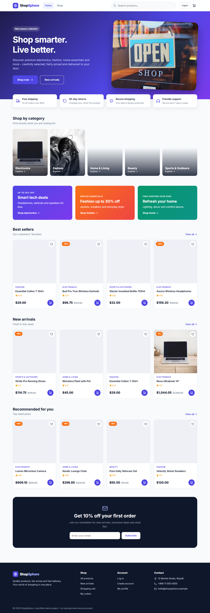
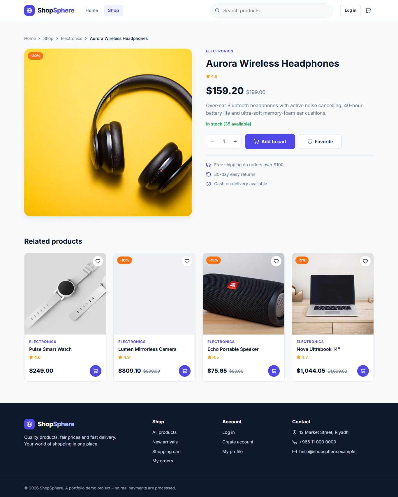
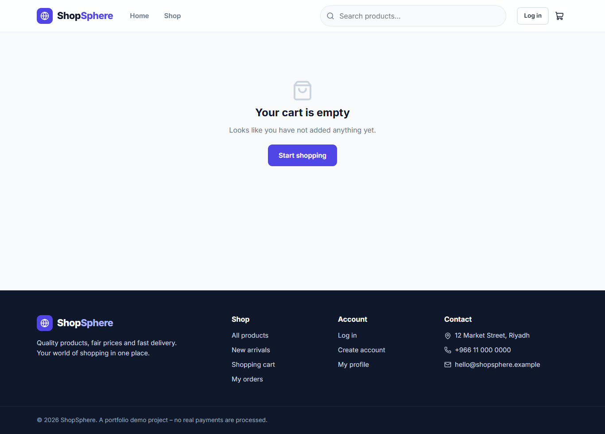
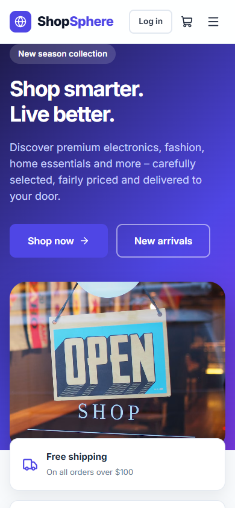

# 🌐 ShopSphere – E-Commerce Website

A modern, responsive online store built with **React + Vite + Supabase**. It includes a customer shop (products, search, filters, cart, checkout, orders, favorites, accounts) and a protected **admin dashboard** (products, orders, categories).

> This is a portfolio project. Checkout uses **Cash on Delivery** – no real payments are processed.



## ✨ Features

**Customers**
- Home page: hero, promo banners, categories, best sellers, new arrivals, recommended, newsletter
- Products page: search by name, filter by category and price, sort by price / newest / rating / popularity (filters live in the URL, so links can be shared)
- Product details: image, price & discount, stock, quantity selector, add to cart, favorites, related products
- Shopping cart: add / remove / change quantity, subtotal, shipping, total, saved in `localStorage`
- Free shipping over \$100, otherwise \$9.99
- Register, login, logout, profile editing, protected pages
- Checkout (Cash on Delivery) saved to Supabase, order confirmation, "My Orders" with status
- Favorites saved per user

**Admin** (`/admin`)
- Overview: total products, orders, customers, sales, recent orders
- Products: add, edit, delete, upload image, price, discount, stock, category
- Orders: view all, view details, change status, search & filter
- Categories: add, edit, delete

**Security** – enforced in the database with Row Level Security (not just hidden links):
- Customers can read only their own profile, orders and order items
- Only admins can change products, categories, order status and see all orders
- Users cannot make themselves admin
- Orders are created by a server-side SQL function (`place_order`) that re-checks prices and stock, so the browser cannot fake prices

## 🧰 Technologies

React 19 · JavaScript (ES6+) · Vite · React Router DOM · CSS3 · Context API · Supabase (PostgreSQL, Auth, Storage) · Lucide React · Git/GitHub

## 📁 Project structure

```
src/
  assets/
  components/   Navbar, Footer, ProductCard, SearchBar, Modal, FormField, ...
  pages/        Home, Products, ProductDetails, Cart, Checkout, OrderSuccess,
                Login, Register, Profile, MyOrders
  admin/        AdminLayout, Dashboard, ProductsManager, OrdersManager, CategoriesManager
  context/      AuthContext, CartContext, FavoritesContext, ToastContext
  hooks/        useCatalog (loads products + categories)
  services/     supabase.js, productService.js, orderService.js, helpers.js, demoData.js
  App.jsx  main.jsx  index.css
supabase/       01_schema.sql, 02_policies.sql, 03_seed.sql
scripts/        generate-seed.js
```

## 🚀 Installation

Requirements: **Node.js 18+** and a free [Supabase](https://supabase.com) account.

```bash
git clone <your-repo-url>
cd shopsphere
npm install
cp .env.example .env     # on Windows: copy .env.example .env
npm run dev              # http://localhost:5173
```

> Without a `.env` file the shop can still be browsed using built-in demo products and the cart works, but login, checkout, orders and the admin area need Supabase and show a clear "not configured" message.

## 🔧 Supabase configuration

1. Create a project at supabase.com.
2. Go to **Project Settings → API** and copy the **Project URL** and the **anon public key**.
3. Put them in `.env`:

```env
VITE_SUPABASE_URL=https://your-project-id.supabase.co
VITE_SUPABASE_ANON_KEY=your-public-anon-key
```

Only the *anon* key belongs in the frontend. **Never** use the `service_role` key here.

4. (Optional, for quick testing) In **Authentication → Providers → Email** turn off "Confirm email" so new accounts can log in immediately. Leave it on in production – the app handles both cases.

## 🗄️ Database setup

Open **SQL Editor** in Supabase and run these files **in order**:

| # | File | What it does |
|---|------|--------------|
| 1 | `supabase/01_schema.sql` | Tables (`profiles`, `products`, `categories`, `orders`, `order_items`, `favorites`), profile-creation trigger, `place_order` function |
| 2 | `supabase/02_policies.sql` | Row Level Security policies + the public `product-images` storage bucket |
| 3 | `supabase/03_seed.sql` | 5 categories and 25 demo products |

`03_seed.sql` is generated from `src/services/demoData.js` with `node scripts/generate-seed.js`.

## 👑 Admin account configuration

There is deliberately **no** admin sign-up page. To create an admin:

1. Register normally in the app.
2. In the Supabase SQL Editor run (use your email):

```sql
update public.profiles
set role = 'admin'
where id = (select id from auth.users where email = 'you@example.com');
```

3. Log out and in again – an **Admin** link appears in the navbar and `/admin` opens.

Any other account that opens `/admin` is redirected home, and even if someone bypassed the frontend, the database policies reject admin actions.

## 📸 Screenshots

| Home | Product details |
|------|-----------------|
|  |  |

| Cart | Mobile |
|------|--------|
|  |  |

## ☁️ Deployment (Vercel or Netlify)

1. Push the project to GitHub.
2. Import the repository on [Vercel](https://vercel.com) or [Netlify](https://netlify.com).
3. Build command: `npm run build` · Output directory: `dist`.
4. Add the environment variables `VITE_SUPABASE_URL` and `VITE_SUPABASE_ANON_KEY` in the host's settings.
5. Single-page-app routing: `vercel.json` / `public/_redirects` are included so refreshing on `/products` works.
6. In Supabase → **Authentication → URL Configuration**, set **Site URL** to your deployed address.

## 🧪 Useful commands

```bash
npm run dev       # development server
npm run build     # production build into /dist
npm run preview   # preview the production build
```

## 🎓 Key React concepts used (interview notes)

- **Components & props** – `ProductCard`, `SearchBar`, `FormField` are reused on many pages.
- **useState / useEffect** – local state (forms, loading, errors) and data loading on page open.
- **Context API** – `AuthContext` (user & role), `CartContext` (cart + totals + localStorage), `FavoritesContext`, `ToastContext`.
- **Custom hook** – `useCatalog()` loads products/categories with loading and error state.
- **React Router** – nested routes, `useParams`, `useSearchParams`, a `ProtectedRoute` wrapper, a separate admin layout with `<Outlet />`.
- **Derived data** – cart totals and product filtering are calculated from state instead of stored separately.
- **Service layer** – components never call Supabase directly; `services/` functions do, and throw readable errors.

## 📄 License

MIT – free to use for learning and your portfolio.

